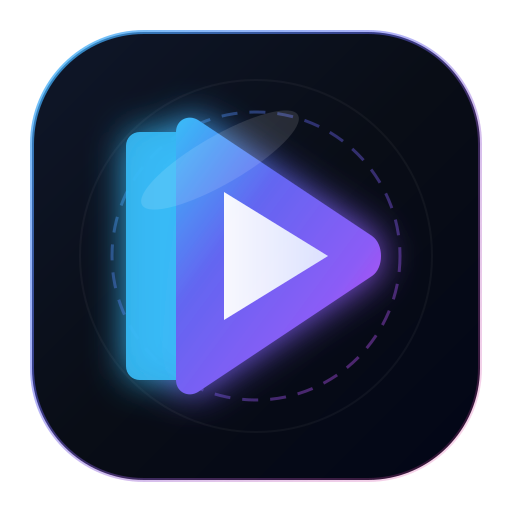

# Lumen Media Player

<div align="center">



### The High-Performance Native Desktop Media Player Built with Rust, Tauri v2, and libmpv

[](LICENSE)
[](https://www.rust-lang.org)
[](https://v2.tauri.app)
[](https://react.dev)
[](https://mpv.io)
[](https://buymeacoffee.com/isahildhillon)
[](https://github.com/sponsors/dhillonsahil)

</div>

---

## 📖 Overview

**Lumen Media Player** is a modern, blazing-fast desktop media player built for power users. Unlike traditional desktop wrappers that attempt to demux or render media inside Chromium or HTML5 `<video>`, Lumen uses **native `libmpv`** as its sole playback engine, combined with hardware Direct3D11 rendering directly attached to the OS window handle (`HWND` / `X11 wid`).

The React 18 + TypeScript frontend acts strictly as a high-performance **glassmorphic control surface** that floats above the native video surface.

```
┌─────────────────────────────────────────────────────────────┐
│                 Lumen Media Player Desktop App              │
├─────────────────────────────────────────────────────────────┤
│  React 18 Control Surface (Vite + Vanilla CSS Glassmorphism) │
│    ├── TitleBar (Branding, Diagnostics, Screenshots, Heart) │
│    ├── TransportBar (Scrubber, 0-200% Vol Boost, A-B Loop) │
│    ├── MiniPlayerOverlay (Compact PiP with native hover)    │
│    └── Unified Settings (General, Video/Color, EQ, Diag)   │
├──────────────────────────┬──────────────────────────────────┤
│    Tauri v2 IPC Bridge   │  MpvEventLoop (Std Thread)       │
│    Async Typed Commands  │  Blocking IPC Event Dispatcher   │
├──────────────────────────┴──────────────────────────────────┤
│                  Media Engine (libmpv)                      │
│    ├── Hardware Decoders: D3D11VA, NVDEC, VAAPI             │
│    ├── Direct3D11 Native Window Embedding (wid)             │
│    ├── Libass Embedded Styled Subtitles (ASS / SSA / SRT)   │
│    └── Audio: AC-3, DTS, FLAC, 10-Band Equalizer Filters    │
├─────────────────────────────────────────────────────────────┤
│   SQLite Library & Resumption DB (rusqlite / WAL mode)      │
└─────────────────────────────────────────────────────────────┘
```

---

## ✨ Features

### 🎬 Native Media Playback Engine
- **Universal Codec & Container Support**: Native decoding for MKV, MP4, WebM, AVI, MOV, TS, FLV, HEVC/H.265, AV1, VP9, H.264, MPEG-2.
- **High-Fidelity Audio**: Full support for multi-channel AC-3 (Dolby Digital), DTS, DTS-HD, TrueHD, FLAC, AAC, Opus, Vorbis, and MP3.
- **Embedded & External Subtitles**: Full vector styling for Advanced SubStation Alpha (`.ass` / `.ssa`), SubRip (`.srt`), WebVTT, and PGS subtitles via `libass`. Auto-detects external subtitle files matching the video name.
- **Hardware Acceleration**: Automatic GPU decoding via `gpu-next` and `d3d11` / `vaapi` / `auto-safe`.
- **Network Streaming**: Direct playback of HLS (`.m3u8`), DASH (`.mpd`), and HTTP/HTTPS network media streams.

### 🎛️ Advanced Control Suite (Phase 5)
- **10-Band Audio Equalizer**: Real-time parametric frequency equalization (31 Hz to 16 kHz) with built-in presets (*Flat, Bass Boost, Vocal Boost, Rock, Pop, Jazz, Classical*).
- **Hardware Video Adjustments**: Live brightness, contrast, saturation, hue, and gamma tuning; 90°/180°/270° video rotation; horizontal and vertical flips; zoom and pan controls; custom aspect ratio overrides (16:9, 4:3, 21:9, auto); hardware deinterlacing.
- **Precision A-B Repeat Loop**: Cycle loop start (Point A) and loop end (Point B) with visual shaded indicators and playhead markers on the seek bar. Press `L` to cycle.
- **PiP Mini-Player Mode**: Instant transformation into a compact 480x270 always-on-top window pinned to the bottom-right corner of the active monitor. Features fluid hover controls, seek scrubber, volume toggle, and native window dragging (`data-tauri-drag-region`).
- **High-Resolution Screenshots**: One-click frame capture saved directly to `Pictures/Lumen` with HUD notification.
- **Volume Boost (up to 200%)**: Software amplification for low-volume audio tracks with warning indicator and clipping protection.
- **Engine Diagnostics**: Real-time overlay showing active VO backend, GPU context, active decoder, dropped frames, cache duration, and stream bitrates.

### 📚 Library & Resumption
- **SQLite Persistence**: Stores media history, resume timestamps, and watched state in WAL-mode SQLite database.
- **Auto-Resume**: Seamlessly picks up playback from the exact second you left off.
- **Drag-and-Drop Playlist Queue**: Reorder items with interactive grip handles; import and export M3U, M3U8, PLS, and XSPF playlist files.

---

## 🛠️ Developer Setup & Forking Guide

If you wish to fork Lumen, contribute to development, or build from source, follow this step-by-step guide.

### 1. Prerequisites

Make sure the following tools are installed on your workstation:

#### **Windows**
1. **Rust Stable (MSVC toolchain)**:
   ```powershell
   rustup default stable-x86_64-pc-windows-msvc
   ```
2. **Node.js**: Version 18.x or 20.x LTS ([Download Node.js](https://nodejs.org/)).
3. **C++ Build Tools**: Visual Studio 2022 C++ Build Tools with Windows 10/11 SDK.
4. **libmpv Development Files**:
   - The repository comes pre-bundled with `packaging/windows/libmpv/libmpv-2.dll` and `mpv.lib`.
   - Ensure `libmpv-2.dll` is present in your project root or `target/debug`/`target/release`.

#### **Linux (Ubuntu / Debian)**
```bash
sudo apt update
sudo apt install -y build-essential curl wget libssl-dev pkg-config \
  libmpv-dev libwebkit2gtk-4.1-dev libgtk-3-dev libayatana-appindicator3-dev librsvg2-dev
```

#### **macOS**
```bash
brew install mpv
```

---

### 2. Clone and Setup

```bash
# Clone your fork
git clone https://github.com/dhillonsahil/lumen.git
cd lumen

# Install frontend dependencies
npm --prefix frontend install
```

---

### 3. Running in Development

You can run the development server using either of the following approaches:

#### Method A: Direct Cargo Execution (Recommended)
In **Terminal 1** (Starts the React / Vite HMR server):
```powershell
npm --prefix frontend run dev
```

In **Terminal 2** (Launches the native Rust host application):
```powershell
cargo run -p lumen-app
```

#### Method B: Tauri CLI
```powershell
cargo tauri dev
```

---

### 4. Running the Test Suite

Lumen has a comprehensive test suite covering the SQLite library, playlist parsing, MpvBackend lifecycle, and media pipeline acceptance tests:

```powershell
# Run all workspace unit and integration tests
cargo test --workspace

# Run static analysis and clippy checks
cargo clippy --workspace --all-targets -- -D warnings

# Format codebase
cargo fmt --all
```

---

### 5. Compiling for Production (Release)

#### Portable Binary (Windows)
```powershell
# 1. Compile frontend production bundle
npm --prefix frontend run build

# 2. Build optimized release binary
cargo build --release -p lumen-app

# 3. Ensure libmpv-2.dll is located alongside lumen-app.exe
Copy-Item "packaging/windows/libmpv/libmpv-2.dll" -Destination "target/release/libmpv-2.dll"
```
The self-contained executable `target/release/lumen-app.exe` and `libmpv-2.dll` can now be run portably or zipped for distribution.

#### Installer Build (NSIS / MSI)
```powershell
cargo tauri build
```
Installers will be generated in `src-tauri/target/release/bundle/nsis/` and `msi/`.

---

## ⌨️ Keyboard Shortcuts Reference

| Shortcut | Action |
|:---|:---|
| <kbd>Space</kbd> / <kbd>K</kbd> | Play / Pause |
| <kbd>→</kbd> | Seek forward 5 seconds |
| <kbd>←</kbd> | Seek backward 5 seconds |
| <kbd>Shift</kbd> + <kbd>→</kbd> | Seek forward 60 seconds |
| <kbd>Shift</kbd> + <kbd>←</kbd> | Seek backward 60 seconds |
| <kbd>↑</kbd> / <kbd>↓</kbd> | Volume Up / Down (up to 200% boost) |
| <kbd>Mouse Wheel</kbd> | Volume Up / Down |
| <kbd>Shift</kbd> + <kbd>Mouse Wheel</kbd> | Frame Scrub / Relative Seek |
| <kbd>M</kbd> | Mute / Unmute audio |
| <kbd>F</kbd> | Toggle Fullscreen mode |
| <kbd>P</kbd> | Toggle Mini-Player (PiP mode) |
| <kbd>L</kbd> | Cycle A-B Repeat Loop (Point A → Point B → Clear) |
| <kbd>A</kbd> | Cycle Aspect Ratio (Auto → 16:9 → 4:3 → 21:9 → 1:1) |
| <kbd>T</kbd> | Audio & Subtitle Track Selector |
| <kbd>Q</kbd> | Toggle Playlist Queue Drawer |
| <kbd>Ctrl</kbd> + <kbd>B</kbd> | Toggle Media Library & History Drawer |
| <kbd>Ctrl</kbd> + <kbd>O</kbd> | Open Media File(s) |
| <kbd>Ctrl</kbd> + <kbd>Shift</kbd> + <kbd>O</kbd> | Open Media Folder |
| <kbd>Ctrl</kbd> + <kbd>U</kbd> | Open Network Stream URL |
| <kbd>S</kbd> | Capture screenshot to `Pictures/Lumen` |
| <kbd>I</kbd> | Toggle libmpv Engine Diagnostics |
| <kbd>Esc</kbd> | Exit fullscreen or dismiss open modals |

---

## ☕ Support & Sponsoring

Lumen v2 is 100% free and open-source software created by independent developers. If you enjoy using Lumen or it saves you time, please consider supporting ongoing maintenance and feature development!

- ☕ **Buy Me a Coffee**: [https://buymeacoffee.com/isahildhillon](https://buymeacoffee.com/isahildhillon)
- 💖 **GitHub Sponsors**: [https://github.com/sponsors/dhillonsahil](https://github.com/sponsors/dhillonsahil)
- ⭐ **Star the Repository**: [https://github.com/dhillonsahil/lumen](https://github.com/dhillonsahil/lumen)

---

## 📜 License

Lumen is licensed under the [MIT License](LICENSE).
Built with [Tauri](https://tauri.app) and powered by [mpv](https://mpv.io).
